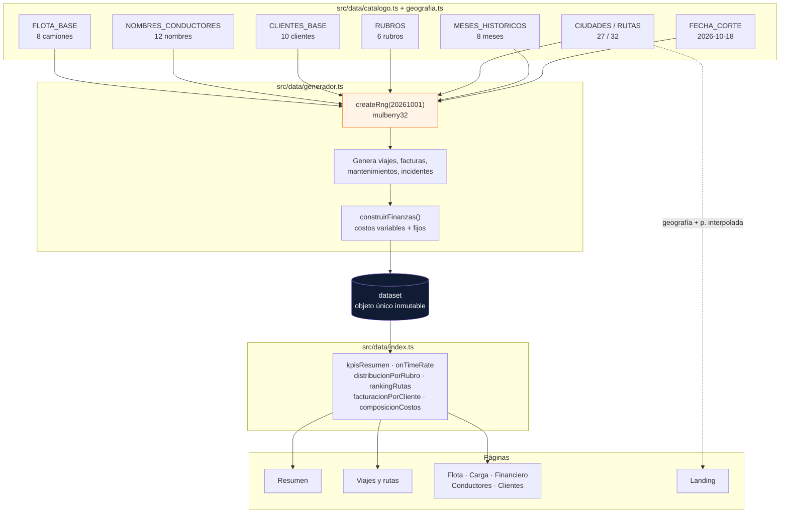
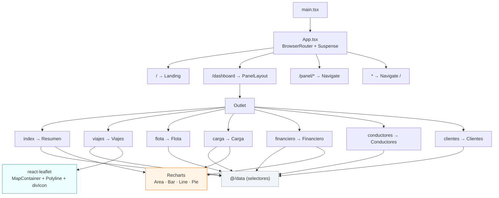
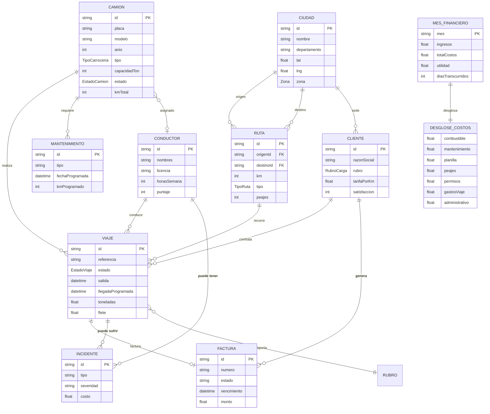

# Empresa Advaluro

> Landing pública y panel operativo para una empresa de **transporte interprovincial en el Perú**.
> Prototipo con datos 100 % simulados: no hay backend, base de datos ni autenticación.

React 19 · TypeScript 6 · Vite 8 · Tailwind CSS 4 · shadcn/ui · React Router 7 · Recharts 3 · Leaflet 5

---

## Índice

1. [Qué es](#qué-es)
2. [Características](#características)
3. [Stack tecnológico](#stack-tecnológico)
4. [Requisitos previos](#requisitos-previos)
5. [Puesta en marcha](#puesta-en-marcha)
6. [Scripts](#scripts)
7. [Cómo ingresar](#cómo-ingresar)
8. [Estructura del proyecto](#estructura-del-proyecto)
9. [Cómo funciona](#cómo-funciona)
10. [El modelo de datos](#el-modelo-de-datos)
11. [La economía del negocio](#la-economía-del-negocio)
12. [Configuración](#configuración)
13. [Componentes UI](#componentes-ui)
14. [Spec Kit y flujo de trabajo con IA](#spec-kit-y-flujo-de-trabajo-con-ia)
15. [Convenciones de código](#convenciones-de-código)
16. [Limitaciones conocidas](#limitaciones-conocidas)
17. [Licencia](#licencia)

---

## Qué es

Simula el panel de control interno de **Empresa Advaluro**, una transportadora interprovincial
peruana que está arrancando su operación. El proyecto cubre las dos caras del producto:

- **Landing pública** (`/`) — página comercial con servicios, cobertura de corredores y contacto.
- **Panel operativo** (`/dashboard`) — siete secciones de gestión interna con KPIs, gráficos y un
  mapa en vivo de las unidades en ruta.

La operación simulada arranca **en rojo** en marzo de 2026 y va cruzando su punto de equilibrio a lo
largo del año, a medida que crece la flota (de 3 a 8 camiones), se incorporan clientes y el equipo de
oficina se refuerza. Los números no son arbitrarios: están calibrados para que esa lectura sea
coherente.

---

## Características

**Landing pública**

- Responsive, con navegación colapsable en móvil.
- Servicios por rubro, corredores principales, ciudades conectadas y contacto.

**Panel operativo**

| Sección | Qué resuelve |
| --- | --- |
| Resumen | Estado del mes, alertas abiertas, composición de costos y ranking de rutas |
| Viajes y rutas | Mapa en vivo, trazados recorrido/restante por unidad, tabla de viajes |
| Flota | Disponibilidad, kilometraje, próximos servicios y mantenimiento programado |
| Mercadería | Tonelaje, ingresos y ocupación por rubro de carga |
| Financiero | Ingresos vs costos, margen, estructura de costos, cartera y facturas |
| Conductores | Puntaje, jornada, incidentes y resumen de seguridad |
| Clientes | Concentración de ingresos, plazos de pago y satisfacción |

**Transversales**

- **Mapa real con OpenStreetMap** (tiles públicos), con marcadores propios porque el icono por
  defecto de Leaflet no se empaqueta con Vite.
- **Datos deterministas**: la misma semilla genera siempre el mismo dataset, así que los gráficos
  no se mueven entre recargas.
- **Moneda y formatos peruanos** vía `Intl` con locale `es-PE`.
- **Tema claro** con tokens de marca (azul marino + naranja industrial) definidos en `src/index.css`.
- **Layout responsive**: sidebar fija en escritorio, `Sheet` deslizante en móvil.
- **Accesibilidad**: iconos con `aria-hidden`, títulos `sr-only` en el menú móvil.

---

## Stack tecnológico

| Capa | Tecnología | Versión |
| --- | --- | --- |
| Runtime | Node.js | 24.21.0 |
| Gestor de paquetes | npm | 12.0.2 |
| Framework | React / React DOM | 19.2.8 |
| Lenguaje | TypeScript | 6.0.2 |
| Bundler | Vite | 8.3.1 |
| Plugin React | `@vitejs/plugin-react` | 6.1.1 |
| Estilos | Tailwind CSS | 4.3.3 |
| Componentes | shadcn/ui (Radix UI + CVA) | — |
| Enrutado | React Router | 7.18.4 |
| Gráficos | Recharts | 3.10.1 |
| Mapas | Leaflet / react-leaflet | 1.9.4 / 5.0.0 |
| Iconos | lucide-react | 1.49.0 |
| Lint | oxlint | 1.81.0 |
| Código generado | Spec Kit + opencode skills | specify-cli 1.0.7 |

---

## Requisitos previos

- **Node.js 24+** y **npm 12+**.
- Conexión a internet para los tiles de OpenStreetMap y para instalar dependencias.

> **Nota Windows / PowerShell.** Si tu política de ejecución bloquea los `.ps1`, npm falla con
> `cannot be loaded because running scripts is disabled`. Usa los ejecutables con extensión
> explícita: `npm.cmd install`, `npm.cmd run dev`, `npx.cmd …`.

---

## Puesta en marcha

```bash
# 1. Instalar dependencias
npm install

# 2. Levantar el servidor de desarrollo
npm run dev
```

Abre **http://localhost:5173**.

| Qué | Dónde |
| --- | --- |
| Web pública | http://localhost:5173/ |
| Panel operativo | http://localhost:5173/dashboard |

Para una build de producción:

```bash
npm run build     # typecheck + bundle en dist/
npm run preview   # sirve dist/ localmente
```

---

## Scripts

| Script | Comando | Qué hace |
| --- | --- | --- |
| `dev` | `vite` | Servidor de desarrollo con HMR |
| `build` | `tsc -b && vite build` | Typecheck estricto y bundle de producción |
| `preview` | `vite preview` | Sirve la build de `dist/` |
| `lint` | `oxlint src` | Lint sobre `src/` |
| `typecheck` | `tsc -b` | Solo verificación de tipos |

> `build` ya ejecuta `tsc -b`, así que un build verde implica typecheck verde.

---

## Cómo ingresar

**No hay login.** El panel es una demo abierta: se llega desde la web pública o por URL directa.

1. Entra a `/` y pulsa **«Panel operativo»** (en el header, en el hero o al final de la página).
2. O ve directo a `/dashboard`.

La sidebar marca la sección activa y el header superior muestra la fecha de corte y la etiqueta
**Demo**. El enlace «Volver a la web pública» del pie de la sidebar regresa a `/`.

<details>
<summary>Rutas completas</summary>

| Ruta | Sección | Contenido principal |
| --- | --- | --- |
| `/` | Landing | Servicios, corredores, ciudades, contacto |
| `/dashboard` | Resumen | KPIs del mes, alertas, gráficos de tendencia |
| `/dashboard/viajes` | Viajes y rutas | Mapa en vivo, unidades en ruta, tabla de viajes |
| `/dashboard/flota` | Flota | Camiones, disponibilidad, mantenimiento |
| `/dashboard/carga` | Mercadería | Distribución por rubro, occupation, equipamiento |
| `/dashboard/financiero` | Financiero | Ingresos/costos, margen, facturas, rutas rentables |
| `/dashboard/conductores` | Conductores | Puntajes, jornada, incidentes |
| `/dashboard/clientes` | Clientes | Cartera, concentración, plazos, satisfacción |
| `/panel/*` | — | Redirige a `/dashboard` (compatibilidad) |
| `*` | — | Redirige a `/` |

</details>

---

## Estructura del proyecto

```
advaluro-web/
├── .opencode/
│   ├── commands/            # 10 comandos speckit.*
│   └── skills/              # 7 skills de UI/UX, marca y diseño
├── .specify/                # Spec Kit: templates, scripts y workflows
├── public/                  # favicon.svg, icons.svg
├── src/
│   ├── components/
│   │   ├── ui/              # 15 componentes shadcn
│   │   ├── kpi-card.tsx     # Tarjeta KPI con variación y tono
│   │   ├── panel-layout.tsx # Shell del panel: sidebar, header, Outlet
│   │   └── seccion.tsx      # Encabezado de sección reutilizable
│   ├── data/
│   │   ├── types.ts         # Interfaces y uniones del dominio
│   │   ├── rng.ts           # PRNG mulberry32 + helpers de redondeo
│   │   ├── geografia.ts     # 27 ciudades, 32 rutas, puntoEnRuta
│   │   ├── catalogo.ts      # Flota, conductores, clientes, rubros, meses
│   │   ├── generador.ts     # Construye el dataset completo
│   │   └── index.ts         # Selectores y KPIs derivados
│   ├── lib/
│   │   ├── formato.ts       # soles, km, fechas, porcentajes, variacion
│   │   ├── tooltip.tsx      # Tooltip monetario de Recharts
│   │   └── utils.ts         # cn() de shadcn
│   ├── pages/
│   │   ├── landing.tsx      # Web pública
│   │   └── panel/           # Las 7 secciones del panel
│   ├── App.tsx              # Rutas y lazy loading
│   ├── main.tsx             # Punto de entrada
│   └── index.css            # Tokens de marca, tema Leaflet
├── components.json          # Configuración de shadcn
├── vite.config.ts           # Plugins y alias @/
└── tsconfig.app.json        # strict + paths
```

---

## Cómo funciona

### Flujo de datos

El proyecto **no consume ninguna API**. Todo nace de un generador determinista y las páginas leen
de ahí mediante selectores.



El PRNG es **mulberry32** con semilla fija `20261001`. Se eligió ese algoritmo porque es corto,
rápido y produce una secuencia estable: recargar la página da exactamente los mismos viajes, las
mismas facturas y los mismos gráficos. Eso permite iterar sobre la UI sin que los datos se muevan
debajo.

### Árbol de rutas y componentes



Todas las páginas se cargan con `React.lazy` dentro de un `Suspense` cuyo fallback es un esqueleto
de carga, así que el bundle inicial solo trae la landing y el shell.

### Los KPIs derivados

`kpisResumen()` no lee números guardados: los calcula a partir de los viajes y las facturas.

| KPI | Fórmula |
| --- | --- |
| `ingresosMes` | Σ `flete` de los viajes con salida dentro del mes en curso |
| `variacionIngresos` | `(ingresosMes − septiembreProrrateado) / septiembreProrrateado × 100` |
| `utilidadMes` | `ingresos − totalCostos` del mes en curso |
| `margenNeto` | `utilidad / ingresos × 100` |
| `onTimeRate` | Viajes `entregado` con `llegadaReal ≤ llegadaProgramada` ÷ viajes cerrados × 100 |
| `cargaUtilizada` | Σ toneladas ÷ Σ capacidad de los camiones usados × 100 |
| `camionesOperativos` | Camiones no en `mantenimiento` ni `fuera_de_servicio` |
| `facturadoPendiente` | Σ monto de facturas `pendiente` + `vencida` |

> ⚠️ **Trampa de lectura.** Octubre está acumulado a **18 de 31 días**. Comparar ese parcial contra
> septiembre completo daría una caída de **−37,7 %** que no refleja la realidad. Por eso
> `prorratear()` recorta septiembre a los mismos 18 días antes de comparar, y el KPI muestra
> **+3,8 %**. La serie de barras del panel financiero sí muestra los meses completos tal cual, con
> octubre etiquetado como acumulado.

### El mapa

`puntoEnRuta(rutaId, progreso)` interpola linealmente entre origen y destino para dibujar el punto
actual de cada unidad, y el avance se calcula sobre el tiempo transcurrido desde la salida. El
recorrido hecho va en línea continua y el restante punteado.

El icono por defecto de Leaflet apunta a imágenes que Vite no empaqueta, así que `viajes.tsx`
construye un `L.divIcon` inline (`crearPin()`), con color según el estado del viaje.

---

## El modelo de datos

### Volúmenes generados

| Entidad | Cantidad | Origen |
| --- | --- | --- |
| Ciudades | 27 | `geografia.ts` (costa, sierra, selva) |
| Rutas | 32 | `geografia.ts` (4 tipos de corredor) |
| Rubros de carga | 6 | `catalogo.ts` |
| Camiones | 8 | `FLOTA_BASE` (5 carrocerías distintas) |
| Conductores | 10 | enrutados desde 12 nombres |
| Clientes | 10 | `CLIENTES_BASE` |
| Viajes históricos | 579 | 8 meses de operación |
| Viajes activos / programados | 6 | generados en torno a la fecha de corte |
| Facturas | 578 | una por viaje cerrado |
| Mantenimientos | 8 | uno por unidad |
| Incidentes | 9 | reparto aleatorio sobre la operación |
| Meses financieros | 8 | marzo – octubre 2026 |

### Entidades y relaciones



---

## La economía del negocio

### Los siete buckets de costo

| Bucket | Naturaleza | Cómo se calcula |
| --- | --- | --- |
| `combustible` | Variable | `(km / 100) × consumo_gal_100km × 17.4 S/gal × ruido(0.94–1.09)` |
| `gastosViaje` | Variable | `60 + km × ruido(0.5–0.6)` — viáticos, casetas, comida, descargas |
| `peajes` | Variable | `nº de casetas × ruido(38–52 S/)` |
| `mantenimiento` | Variable | `km × ruido(0.52–0.68 S/)` |
| `planilla` | Fijo | `(unidades_pagadas × 4.500 + oficina_del_mes) × factor_días` |
| `permisos` | Fijo | `permisos_del_mes × factor_días` |
| `administrativo` | Mixto | `(ingresos × 2.6 % + fijo_del_mes) × factor_días` |

`factor_días = diasTranscurridos / diasDelMes`. **Solo se aplica al mes en curso**; los meses ya
cerrados cargan su costo fijo completo. Sin esto, un mes parcial aparecería artificialmente en rojo.

El consumo de diesel según carrocería (galones por 100 km, a velocidad de ruta):

| Carrocería | Gal/100 km |
| --- | --- |
| Plataforma | 10.0 |
| Refrigerado | 11.6 |
| Cisterna | 11.2 |
| Tolva | 12.4 |
| Volquete | 13.8 |

### La rampa de arranque

| Mes | Camiones | Viajes/mes | Ingresos | Costos | Utilidad |
| --- | --- | --- | --- | --- | --- |
| Mar | 3 | 26 | S/ 44.776 | S/ 59.229 | **−S/ 14.453** |
| Abr | 4 | 44 | S/ 97.401 | S/ 95.136 | S/ 2.265 |
| May | 5 | 62 | S/ 147.384 | S/ 129.723 | S/ 17.661 |
| Jun | 6 | 80 | S/ 134.151 | S/ 131.537 | S/ 2.614 |
| Jul | 7 | 92 | S/ 178.630 | S/ 164.784 | S/ 13.846 |
| Ago | 7 | 100 | S/ 229.423 | S/ 197.292 | S/ 32.131 |
| Sep | 8 | 108 | S/ 201.379 | S/ 186.094 | S/ 15.285 |
| Oct *(18/31 días)* | 8 | 67 | S/ 125.397 | S/ 110.874 | S/ 14.523 |

Marzo pierde dinero porque la planilla y los permisos son fijos mientras el volumen aún es bajo.
Abril cruza el equilibrio. Junio y septiembre se debilitan por la estacionalidad de la demanda:
los viajes largos son más caros de operar, así que el margen cae aunque el volumen de flete no.

Los costos fijos suben con la operación, vía tres rampas indexadas por mes en `generador.ts`:
`OFICINA_MENSUAL`, `PERMISOS_MENSUAL` y `ADMIN_FIJO_MENSUAL`.

### Composición de costos de octubre

| Bucket | Monto | % del total |
| --- | --- | --- |
| Combustible | S/ 43.663 | 39.4 % |
| Planilla | S/ 26.245 | 23.7 % |
| Gastos de viaje | S/ 16.487 | 14.9 % |
| Mantenimiento | S/ 13.283 | 12.0 % |
| Peajes | S/ 5.529 | 5.0 % |
| Administrativo | S/ 3.461 | 3.1 % |
| Permisos | S/ 2.206 | 2.0 % |
| **Total** | **S/ 110.874** | **100 %** |

---

## Configuración

| Variable | Archivo | Valor actual | Para qué sirve |
| --- | --- | --- | --- |
| `SEMILLA` | `data/generador.ts` | `20261001` | Cambiarla regenera **todo** el dataset con otra secuencia |
| `FECHA_CORTE` | `data/catalogo.ts` | `2026-10-18T08:00:00-05:00` | Ancla de «hoy»: define qué viajes están en curso, programados o cerrados |
| `MESES_HISTORICOS` | `data/catalogo.ts` | 8 meses | Ventana de la serie financiera |
| `FLOTA_BASE` | `data/catalogo.ts` | 8 unidades | Camiones, con taller y capacidad |
| `CLIENTES_BASE` | `data/catalogo.ts` | 10 empresas | Rubro, tarifa por km, satisfacción, plazo de pago |
| `RUBROS` | `data/catalogo.ts` | 6 rubros | Nombre, descripción y requisitos de equipamiento |
| `PRECIO_DIESEL` | `data/generador.ts` | `17.4` S/gal | Precio del combustible del periodo |
| `CONSUMO_GAL_100KM` | `data/generador.ts` | 10.0 – 13.8 | Consumo por tipo de unidad |
| `PLANILLA_POR_CONDUCTOR` | `data/generador.ts` | `4500` | Costo mensual por conductor con beneficios |
| `OFICINA_MENSUAL` | `data/generador.ts` | 8 valores | Rampa de gasto de oficina |
| `AHORA` | `pages/panel/*.tsx` | `2026-10-18T08:00:00-05:00` | Reloj del panel para el avance de las unidades en el mapa |
| Alias `@` | `vite.config.ts` + `tsconfig.app.json` | `./src` | Imports absolutos: `import { kpisResumen } from '@/data'` |
| Tiles OSM | `pages/panel/viajes.tsx` | `tile.openstreetmap.org` | Fondo del mapa; requiere conexión |

> ⚠️ Si cambias `FECHA_CORTE`, actualiza también la constante `AHORA` de las páginas del panel y el
> badge «Datos al 18 oct 2026» de `panel-layout.tsx`, o el mapa mostrará posiciones incoherentes.

---

## Componentes UI

15 componentes de **shadcn/ui** en `src/components/ui/`, estilo `new-york` con CSS variables:

`avatar` · `badge` · `button` · `card` · `dropdown-menu` · `input` · `label` · `progress` ·
`select` · `separator` · `sheet` · `skeleton` · `table` · `tabs` · `tooltip`

Dos componentes propios construidos sobre shadcn:

- `kpi-card.tsx` — tarjeta KPI con valor, icono, tono semántico y variación con flecha.
- `seccion.tsx` — encabezado de sección con título y descripción.

### Nota sobre el CLI de shadcn

`npx shadcn@latest add …` **no funciona en este proyecto con npm 12**: falla con el error
`EALLOWSCRIPTS` (npm 12 exige habilitar explícitamente los scripts de instalación) y además la
versión actual del CLI no acepta el flag `--base-color` que documenta su propio output. Los
componentes se descargaron manualmente del registry público. `package.json` incluye
`allowScripts.esbuild` para que el build funcione, y `components.json` declara `"style": "new-york"`
(declaraba `radix-nova` por un artefacto del `init` abortado).

`progress.tsx` recibió una modificación manual: el `ProgressIndicator` no llevaba selector de
clase, así que se agregó `indicatorClassName` para poder colorear la barra por contexto.

---

## Spec Kit y flujo de trabajo con IA

El proyecto se generó con [Spec Kit](https://github.com/github/spec-kit) integrado con **opencode**
(y no con copilot, que fue el error del primer intento).

| Ruta | Contenido |
| --- | --- |
| `.specify/` | Templates de spec/plan/tasks, scripts PowerShell, workflows y constitución |
| `.opencode/commands/` | 10 comandos `speckit.*` (specify, plan, tasks, implement, analyze, clarify, checklist, constitution, converge, taskstoissues) |
| `.opencode/skills/` | 7 skills: `ui-ux-pro-max`, `brand`, `design`, `design-system`, `ui-styling`, `banner-design`, `slides` |

Workflow típico: `/speckit.specify` → `/speckit.clarify` → `/speckit.plan` → `/speckit.tasks` →
`/speckit.implement`.

`.gitignore` incluye `.opencode/*` pero re-incluye `commands/`, `skills/` y `agents/`, para versionar
las skills y comandos del proyecto sin arrastrar posible estado local ni credenciales.

---

## Convenciones de código

- **Todo el texto visible va en español.** Nombres de variables, funciones y tipos en inglés.
- **Formato numérico y monetario** siempre a través de `src/lib/formato.ts` (`soles`, `solesCompacto`,
  `km`, `numero`, `porcentaje`, `fechaCorta`, `variacion`). Nada de `toLocaleString` suelto.
- **TypeScript estricto**: `strict`, `noUnusedLocals`, `noUnusedParameters`, `verbatimModuleSyntax`,
  `erasableSyntaxOnly`. Nada de `any` en las páginas; los tooltips de Recharts usan el helper
  `valorNumerico()` de `formato.ts` porque su `value` viene como `string | number | array`.
- **Imports con `import type`** para tipos, requerido por `verbatimModuleSyntax`.
- **Sin barrel files**: cada módulo se importa por su ruta (`@/data`, no un `index` gigante).
- **Iconos** siempre con `aria-hidden` cuando son decorativos.
- **Tokens de color** mediante variables CSS (`--chart-1`…`--chart-6`, `--success`, `--info`,
  `--warning`), nunca colores hardcodeados en el JSX.
- **Comentarios en español**, explicando el *porqué* del número mágico, no el *qué* hace la línea.

---

## Limitaciones conocidas

- **No hay backend ni autenticación.** El panel es público y todo se genera en el cliente al cargar.
- **No hay tests.** Ni unitarios ni end-to-end. La verificación actual es `build` + `lint` + revisión
  visual de las cifras.
- **Sin commit inicial.** La rama `main` existe pero el repositorio todavía no tiene ningún commit.
- **7 componentes shadcn sin usar**: `avatar`, `dropdown-menu`, `input`, `label`, `select`, `tabs`,
  `tooltip`. Están disponibles para cuando hagan falta.
- **Rama muerta en el generador.** En `generador.ts`, la variable `programado` nunca puede ser
  verdadera (la condición de `enCurso` la absorbe siempre), así que en la práctica solo existen
  viajes `en_curso`, `entregado` y `retrasado`. Está pendiente de simplificar.
- **`dist/` está en `.gitignore`**, así que la build no se versiona.
- **El mapa necesita internet** y está sujeto a la [política de uso de tiles](https://operations.osmfoundation.org/policies/tiles/)
  de OpenStreetMap. Para producción habría que usar un proveedor propio.
- **Sin i18n.** La interfaz está en español fijo; no hay conmutador de idioma.
- **Sin tema oscuro.** Solo hay tokens de tema claro.
- **`npm run dev` con `StrictMode`** hace doble render en desarrollo: es intencional para detectar
  efectos impuros, pero duplica el cálculo del dataset en la consola.

---

## Licencia

MIT. Prototipo demostrativo: la marca, los clientes, las tarifas, los teléfonos y todas las cifras
son ficticios.
